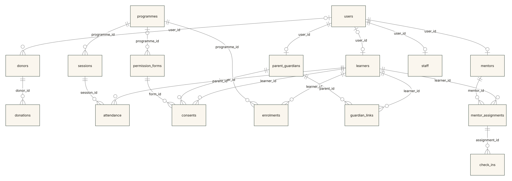
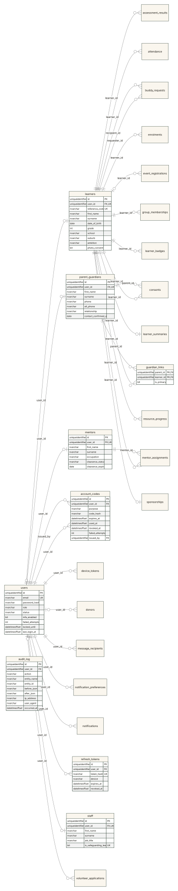
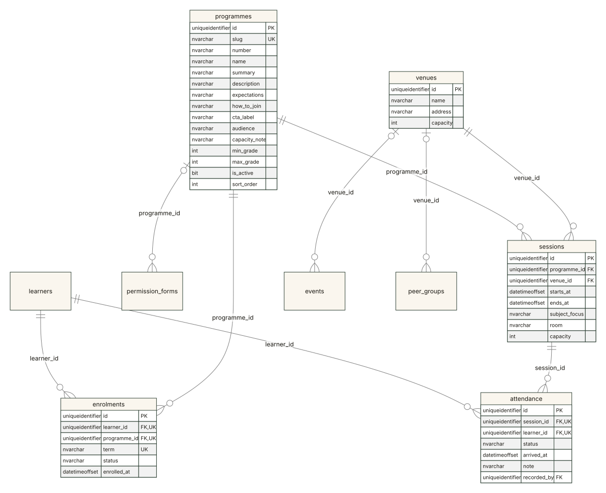
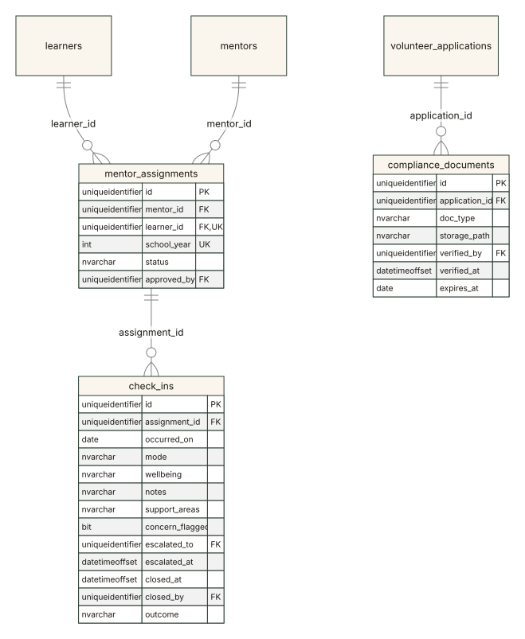
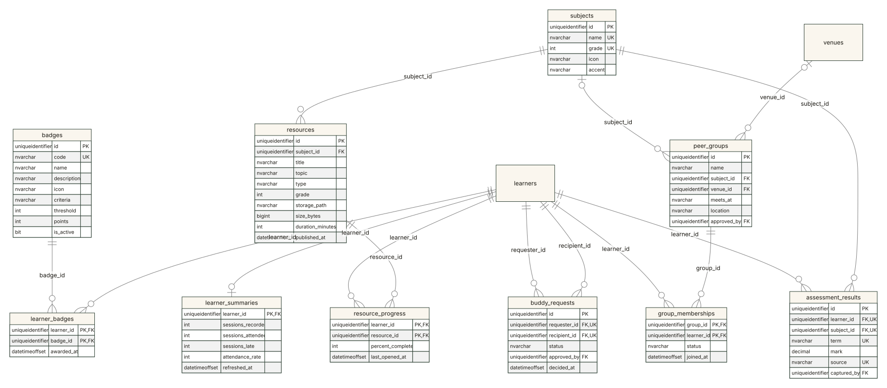
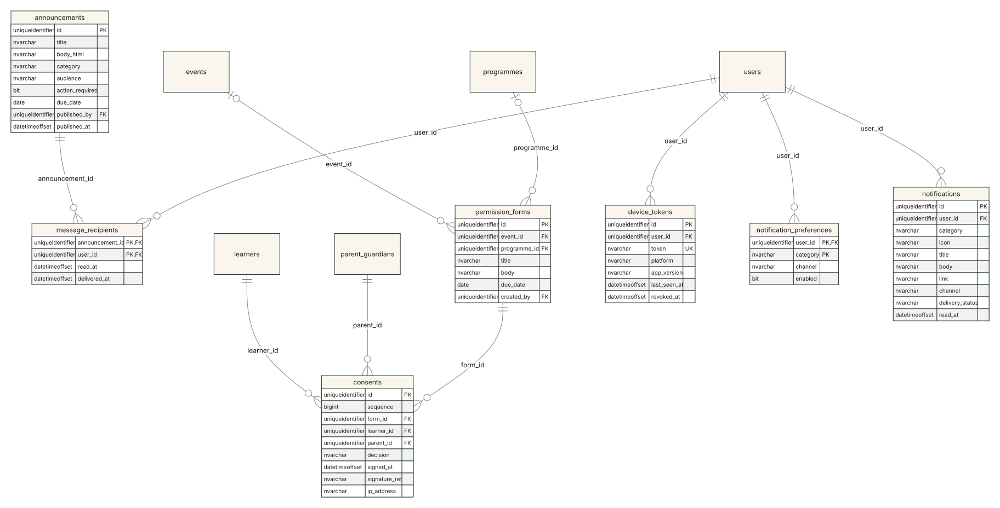
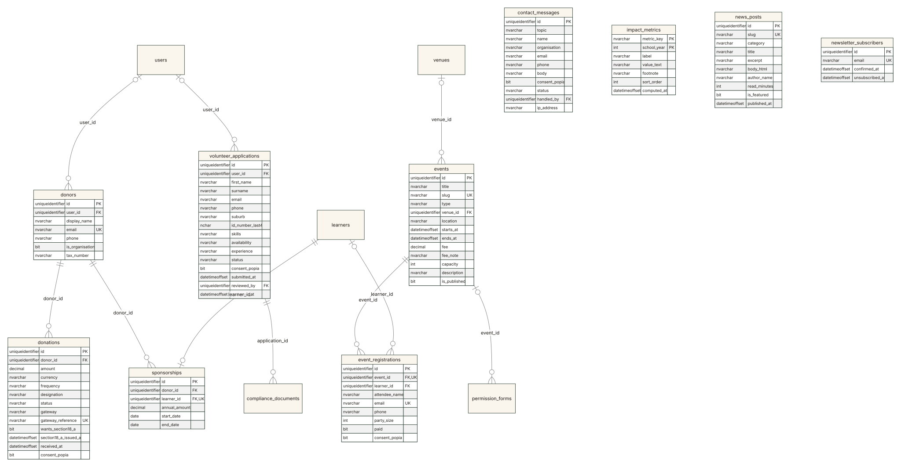

# Entity-relationship diagrams

Generated from the **live database schema**, not drawn by hand — so the
diagrams cannot disagree with the tables they describe. 44 tables, 449 columns,
64 foreign keys.

| File | What |
|---|---|
| `erd/*.mmd` | Mermaid sources — edit these, then re-render |
| `erd/*.svg` | Vector renders, for the documentation and for printing |
| `erd/*.png` | 2× raster renders, for slides |

Colours are the Heritage palette, so the diagrams match the site, the console
and the app.

## Reading the notation

Crow's foot, the standard notation for relational models.

| Symbol at an end | Means |
|---|---|
| `\|\|` | exactly one |
| `o\|` | zero or one |
| `o{` | zero or many |

So `learners ||--o{ attendance` reads *one learner has zero or many attendance
marks, and every mark belongs to exactly one learner*. Each line is labelled
with the foreign-key column that implements it.

Columns are marked **PK** (primary key), **FK** (foreign key) and **UK** (part of
a unique index). A column marked UK on its own is unique by itself; two columns
marked UK in the same table are unique *together* — `mentor_assignments` has
`learner_id` and `school_year` marked UK because a learner has one mentor per
school year, not one mentor ever.

Timestamps and `updated_by`, which every table carries, are left out to keep
the boxes readable.

### One deliberate omission

Thirteen columns record **who did something** — `attendance.recorded_by`,
`check_ins.escalated_to`, `check_ins.closed_by`, `announcements.published_by`
and nine more. Every one is a foreign key to `users` and is marked **FK** in its
table. The lines are not drawn: thirteen more edges into one table turn every
diagram into a starburst and hide the relationships worth reading.

---

## The core model

The sixteen tables the system's main stories run through: who a person is,
what they are enrolled in, whether they attended, who mentors them, what their
parent agreed to, and who gave money.



What to notice:

- **`users` is one-to-zero-or-one with each profile table.** A person is a
  learner, a parent, a mentor or staff — the unique index on each profile's
  `user_id` is what makes "not two of them" true rather than assumed.
- **A learner does not need an account.** `learners.user_id` is optional: a
  Grade 8 learner without a phone is still on the register, and their parent
  follows them in the app.
- **`guardian_links` is the parent boundary.** A parent sees a child only
  through a row here, created by staff at enrolment — never through anything the
  parent claims.
- **`check_ins` hang off `mentor_assignments`, not off the mentor.** A note is
  about a pairing in a school year, which is what lets a concern be traced to
  the assignment it arose in after the mentor has moved on.
- **`consents` point at the learner, the parent *and* the form.** A decision is
  one parent's answer, about one child, to one question.

---

## By area

Each area is drawn with its columns. A table from another area appears as an
empty box where a relationship crosses the boundary.

### People and access

`users`, the four profile tables, `guardian_links`, `refresh_tokens`, `audit_log`.



`refresh_tokens.token_hash` is a SHA-256 hash, never the token. `audit_log`
has an `INSTEAD OF UPDATE, DELETE` trigger: the database refuses to change or
remove an entry, including for an administrator with a SQL client.

### Programmes and attendance



`attendance` is unique on `(session_id, learner_id)` — one mark per learner per
session, which is what makes capturing a register twice an error rather than a
double count.

### Mentorship and safeguarding



`check_ins.escalated_to` and `closed_by` are foreign keys to `users`: a concern
is routed to a real person and closed by one. A filtered index on
`concern_flagged = 1 AND closed_at IS NULL` is exactly the safeguarding queue.

### Learning, progress and peers



`buddy_requests` has a check constraint that a learner cannot request
themselves, and `approved_by` — a staff user — is the only way a request becomes
a pairing.

### Consent and communication



`consents` has an `INSTEAD OF UPDATE, DELETE` trigger. Withdrawing permission is
a new row with a higher `sequence`, never an edit, so the full history of what a
parent agreed to and when they changed their mind stays reconstructible. The
foreign key to `permission_forms` is `NO ACTION` on delete: a form that has been
answered cannot be deleted out from under its answers.

### Giving and the public site



`donations` has no column that could hold a card number, and
`volunteer_applications.id_number_last4` is four characters wide — both are
POPIA decisions expressed as schema.

---

## Everything at once

All 43 tables and their relationships, without columns. Useful for seeing that
nearly everything hangs off `users` and `learners`; too dense to present.

[Open the full overview](erd/overview.svg)

---

## Regenerating

```bash
python docs/erd/generate.py
```

[`generate.py`](erd/generate.py) reads `sys.columns` and `sys.foreign_keys`
from the development database, writes the Mermaid sources, and renders each to
SVG and PNG with Mermaid 11 in headless Edge. Nothing is installed; it needs
SQL Server, a network connection for the Mermaid script, and Python.

Run it after any migration that changes a table or a relationship. An ERD that
has drifted from the schema is worse than none, because it is believed. If a
migration adds a table, the script refuses to run until the table is placed in
an area, so a new table cannot silently go undrawn.
